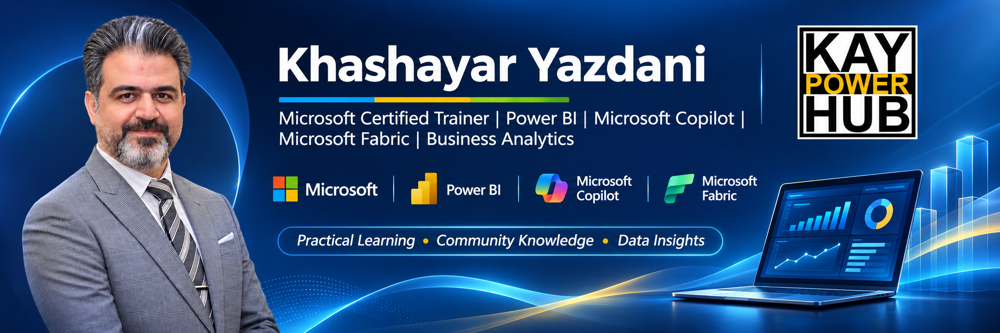

  

# Khashayar Yazdani

  
  
  
  

**Microsoft Certified Trainer | Power BI | Microsoft Copilot | Business Analytics | AI and Intelligent Transformation**

Welcome to my GitHub profile!

I am a Microsoft Certified Trainer, author, and technology educator passionate about empowering professionals and organizations through Microsoft technologies, data analytics, and artificial intelligence.

## Areas of Expertise

**Microsoft Power BI:** Business intelligence, data visualization, DAX, Power Query, and dashboard development.

**Microsoft Copilot:** AI productivity, business applications, and intelligent workflows.

**Business Analytics:** Data-driven decision-making, KPI development, and analytical solutions.

**Microsoft Fabric:** Modern data analytics and enterprise intelligence.

## Community Contributions

Through KAY POWER HUB, I share practical learning resources, technical tutorials, dashboards, analytics templates, and Microsoft technology insights.

My goal is to help professionals learn, apply, and benefit from Microsoft technologies through practical knowledge sharing.

## Publications

**Business Analytics with Power BI**

**Agentic AI: Leading the Next Wave of Intelligent Transformation**

## Connect With Me

[LinkedIn](https://www.linkedin.com/in/khashayary/)

[GitHub](https://github.com/khashayary)

## KAY POWER HUB

Empowering the community through Business Analytics, Artificial Intelligence, and Microsoft technologies.
